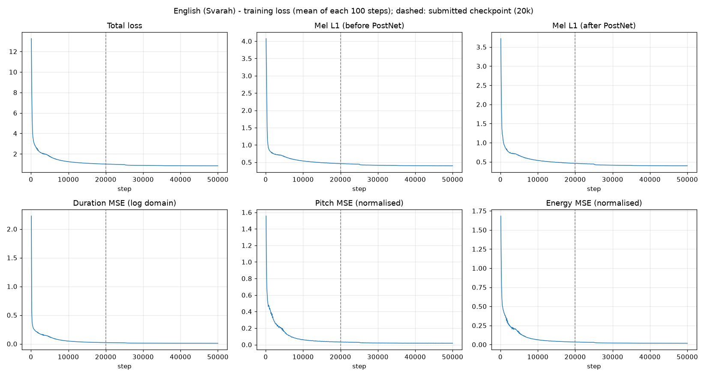
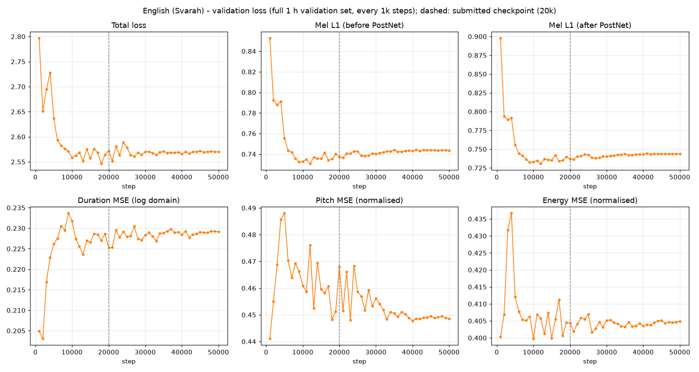
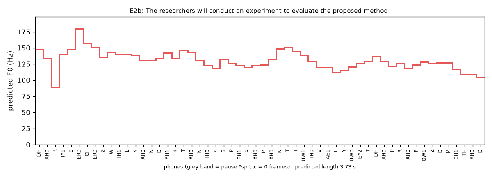
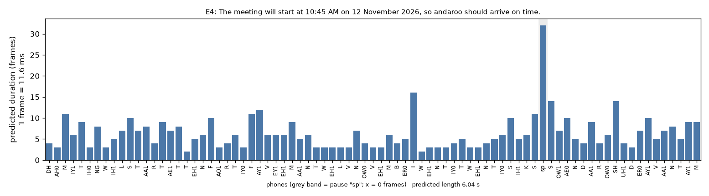

> **Status of this draft.** The English model is trained and evaluated, and every number below comes from files in the repository. The Telugu model has **not been trained yet**. Its data selection, front end and alignment pipeline are described here, and the sections marked *Pending (Telugu)* will be filled from real runs. No Telugu result in this draft is estimated or invented.

# 1. Summary

| | English | Telugu |
|---|---|---|
| Data | Svarah (ai4bharat), Indian-accented English, 113 speakers | IndicTTS Telugu (IIT Madras), one male speaker |
| Train / validation | 5.000 h (3,417 utts) / 1.000 h (757 utts), disjoint | 5.000 h (2,623 utts) / 1.000 h (524 utts), disjoint (split done) |
| Model | FastSpeech 2 (ming024), 35.4 M parameters, multi-speaker, **trained from scratch** | same architecture, single speaker, Telugu phone set |
| Alignment | MFA 3.4.3, pretrained `english_us_arpa` | MFA 3.4.3 acoustic model **trained on this corpus** with a rule-based Telugu lexicon |
| Vocoder | pretrained HiFi-GAN "universal" (frozen) | same |
| Training | 50k steps (T4 fp32 for 0–20k, L4 bf16 for 20k–50k) | *pending* |
| Submitted checkpoint | step 20,000 (`project/English/checkpoints/20000.pth.tar`) | *pending* |

All parameters of the acoustic model were randomly initialised and trained. No pretrained acoustic weights, frozen layers or LoRA were used. The only pretrained component is the vocoder, which turns mel-spectrograms into waveforms.

# 2. Architecture and modifications

**Reference implementation.** [ming024/FastSpeech2](https://github.com/ming024/FastSpeech2) at commit `d4e79eb` (MIT), with its bundled HiFi-GAN (MIT). This is FastSpeech 2 "v1", which uses raw F0 rather than a CWT pitch spectrogram, plus a Tacotron-2 PostNet.

- **Pipeline:** phoneme embedding → 4-layer FFT encoder (256-d, 2 heads, conv 1024, kernel [9, 1]) → speaker embedding (English only) → variance adaptor → 6-layer FFT decoder → linear to 80 mel bins → 5-layer PostNet.
- **Variance adaptor:** three predictors for duration, pitch and energy (2 conv layers, 256 filters, kernel 3, dropout 0.5) and a length regulator. Pitch and energy are predicted at **phoneme level** and fed back as embeddings over 256 linear bins.
- **Loss:** L1(mel) + L1(PostNet mel) + MSE(log(d+1)) + MSE(pitch) + MSE(energy). Pitch and energy are measured in z-scored units, and all terms are masked to valid frames or phones.
- **Training vs inference:**
  - *Training:* the decoder is conditioned on the **ground-truth** durations, pitch and energy (teacher forcing), while the predictors are trained against them.
  - *Inference:* only text (and a speaker id) is given, and the predicted values are used. This is why the validation audio saved during training, which is teacher-forced, sounds better than true text-to-speech output.

**Changes to upstream.** The network, loss, optimiser schedule and Dataset are unchanged.

- **Compatibility patch** (`patches/ming024_fastspeech2_compat.patch`):
  - CPU support for the STFT;
  - keyword arguments for librosa 0.10 or newer;
  - safe `weights_only` checkpoint loading;
  - HiFi-GAN paths that no longer depend on the working directory;
  - UTF-8 `.lab` reading;
  - a fix for an upstream bug where the energy embedding was scaled by the *pitch* control.
- **MFA 3 silences** (`fs2ra/features.py`): MFA 3 leaves pauses as *empty* intervals, which upstream's TextGrid reader drops. Every internal pause would then be missing from the duration sequence, so all targets after the first pause would be misaligned **with no error raised**. Empty intervals are relabelled `sp` before upstream's unchanged `process_utterance` runs.
- **Splits and statistics:**
  - splits come from our manifests;
  - pitch/energy mean, std and bin ranges are fitted on the **train split only** (upstream uses train+val);
  - every utterance is checked: duration sum equals mel frames, one pitch/energy value per phone, all values finite.
- **Training loop** (`fs2ra/training.py`, replacing upstream `train.py`):
  - automatic resume and atomic checkpoint writes;
  - checkpoint pruning plus model-only milestones every 10k steps;
  - CSV loss logs and optional mixed precision (bf16 on L4);
  - a snapshot of `stats.json`, `speakers.json` and the config next to the checkpoints, so inference uses exactly the training normalisation.
- **Symbol table** (`fs2ra/symbols.py`): upstream's `text_to_sequence` silently **drops** unknown phones. The Telugu phone set is appended to the symbol table before the model is built, and training refuses to start if any train or validation phone does not map to an id. English keeps the upstream 360 symbols.
- **Inference** (`fs2ra/inference.py`): a text-only front end, described in §7.

**Feature configuration.**

- 22,050 Hz audio, n_fft 1024, hop 256 (11.6 ms per frame), 80 mel bins, 0–8 kHz, natural-log mel.
- This matches the HiFi-GAN configuration, which is asserted in `tests/test_upstream_compat.py`.
- English audio is 16 kHz and is resampled. Because its Nyquist frequency (8 kHz) equals mel f_max, the mel band has no empty region.

# 3. Data selection and sampling

Hours were measured from the decoded audio, not taken from dataset cards. Each rejected utterance is logged with a reason (`project/<Lang>/splits/rejected.csv`). The splits are:

- deterministic (seed 1234);
- grouped by normalised transcript, so no sentence appears in both train and validation;
- stratified by speaker;
- checked by tests: disjoint ids, audio hashes and transcripts, hour targets, and validation speakers being a subset of training speakers.

**English — Svarah** (`ai4bharat/Svarah` @ `ebbf777`, CC BY 4.0).

- **Corpus:** 6,656 utterances, 9.61 h, 16 kHz. It is an ASR benchmark with read *and* spontaneous speech.
- **Speakers:** there is no speaker column. The 2,938 recording ids are sessions, not people. Each session maps to one demographic profile, and the 115 distinct profiles (the paper reports 117 speakers) are used as speaker ids.
- **Quality control:** removes < 1 s (1,215 utterances), > 15 s (261), too quiet (< −40 dBFS RMS, 160) and speaking-rate outliers (24). This leaves 7.71 h.
- **Split:** 5.04 h train and 1.03 h validation over 113 speakers. The rest is a reserve used only to replace utterances that fail alignment.
- **After alignment** (§4): **train 5.000 h / 3,417 utts, validation 1.000 h / 757 utts**.
- **Why multi-speaker:** the median speaker has only about 1.9 min of training audio (largest 10.6 min), so a single-speaker model is impossible on this corpus.
- **Deliberate asymmetry:** validation was filled first with clean ≤ 11 s, digit-free clips. Train additionally contains 254 utterances of 11–15 s or with digits.

**Telugu — IndicTTS Telugu** (`SPRINGLab/IndicTTS_Telugu` @ `7ab3c18`).

- **Measured vs card:** 36.7 h and two speakers, against the card's ~8.7 h. The female recordings are 16 kHz and mostly long paragraphs (up to 151 s). The male recordings are 48 kHz sentences.
- **Choice: the single male speaker.** It gives 8.06 h of clips ≤ 15 s after quality control, against 3.6 h for the female voice, and it keeps one consistent recording chain.
- **Split:** **5.000 h train (2,623 utts) / 1.000 h validation (524 utts)**, all ≤ 11 s.
- **Rejected for quality:**
  - transcripts where a Latin `o` was typed instead of the anusvara `ం` (11 utterances, rejected rather than silently corrected);
  - speaking-rate outliers that turned out to be audio/transcript mismatches.

# 4. Preprocessing

**English.**

1. **Export:** resample 16 → 22.05 kHz, peak-normalise.
2. **Spoken-form text** (`fs2ra/text_en.py`):
   - times ("10:45 AM" → "ten forty five a_m"), years, ordinals and decades;
   - digit strings of 5 or more digits read digit by digit;
   - symbols and abbreviations.

   The same function is used at inference.
3. **Dictionary:** LibriSpeech lexicon with all variants, and g2p_en for 1,395 out-of-vocabulary words (mostly Indian names, places and brands). All-caps acronyms get both a spelled-out and a g2p variant.
4. **MFA 3.4.3** with `english_us_arpa`, speaker-adapted: 4,988 of 4,996 aligned.
5. **Targets** via upstream `process_utterance`:
   - durations from the TextGrid, with leading and trailing silence trimmed;
   - log-mel spectrogram;
   - F0 from WORLD dio + stonemask, linearly interpolated across unvoiced frames and averaged per phone;
   - energy as the per-frame L2 norm of the STFT magnitude, averaged per phone.

   Pitch and energy are z-scored with train-only statistics: pitch mean 176.3 Hz, std 55.3; energy mean 52.5, std 37.7.
6. **Rejection:** 437 utterances whose longest non-silence phone exceeds 0.58 s, mostly filled pauses ("uhh") or untranscribed speech absorbed into a single `AH0`. They were replaced from the reserve without reintroducing train/validation overlap.

**Telugu.**

- **No pretrained MFA model or lexicon exists for Telugu**, so `fs2ra/text_te.py` implements a rule-based grapheme-to-phoneme converter for the Telugu abugida. Its 49 ASCII phones cover:
  - the inherent vowel /a/ and its suppression by virama;
  - vowel signs;
  - homorganic anusvara (`రంగం` → r a ng g a m);
  - vocalic r (`ృ` → r u) and visarga (→ h);
  - geminates.
- **Number verbalisation** handles cardinals, ordinals (`12వ` → పన్నెండవ) and times.
- **Alignment:** an MFA acoustic model is **trained on the Telugu corpus itself** (`mfa train`) and produces the alignments. This runs on a Colab CPU high-RAM runtime because the local machine ran out of memory.
- *Pending (Telugu):* alignment statistics, rejected utterances, and the final feature set.

# 5. Training setup

| | |
|---|---|
| Optimiser | Adam (β 0.9/0.98, ε 1e-9), Noam warm-up 4,000 steps, ×0.3 at 25k/35k/45k; gradient clip 1.0 |
| Batch | 16 (upstream length-sorted groups of 4 batches) |
| Budget | 50,000 steps ≈ 235 epochs of the English train set (upstream: 900k steps on 24 h of LJSpeech) |
| Validation | full 1 h validation set every 1,000 steps; loss = same objective with teacher forcing |
| Checkpoints | full (model + Adam) every 2k steps, model-only milestone every 10k |
| Hardware (English) | Colab T4, fp32, steps 0–20k (median 0.64 s/step, ≈3.6 h); Colab L4, bf16 autocast, steps 20k–50k after resuming (0.18 s/step, ≈1.5 h). Weights and optimiser state are kept in fp32; the switch is transparent to the optimiser schedule. |

# 6. Convergence and instability (English)





- **Stability:** training was stable. There were no NaN or inf values, no loss spikes after warm-up, and resuming and switching GPU and precision at step 20k left no visible discontinuity.
- **Training loss** fell from 13.3 (step 100) to 1.01 (20k) and 0.84 (50k).
- **Validation total** reached 2.65 at 2k, 2.56 at 10k, and its minimum of 2.546 at 18k. It was 2.572 at 20k and 2.570 at 50k: a **plateau from about 8–10k steps**, without divergence.
- **Overfitting:** after about 10k steps the gap widens steadily.
  - Training pitch, energy and duration losses fall to 0.018 / 0.017 / 0.010.
  - The validation values stay at about 0.45 / 0.40 / 0.23.
  - Validation duration loss was actually lowest at 1k steps (0.205) and rose slowly afterwards. The duration predictor memorises the training rhythm early.
- **Comparison with trivial predictors** (validation, normalised units):

  | Predictor | Model | Baseline | Meaning |
  |---|---|---|---|
  | Energy | 0.40 | 1.03 (per-speaker mean) | Genuine learning |
  | Duration | 0.23 | 0.256 (per-phone mean log-duration) | Small gain |
  | Pitch | ≈0.45 | 0.480 (per-speaker mean) | **Little beyond speaker identity** |

  The model's intonation is therefore expected to be flat. The cause is the data: spontaneous ASR speech, about 2 min per speaker, and varied recording conditions. No pipeline bug was found: the target checks pass and the predictors beat their baselines.
- **Checkpoint selection:** validation losses at 20k and 50k are equivalent. The 18k minimum was not kept, because only every 10k is retained as a milestone. Both were synthesised with the same front end, and **20k was preferred on listening**, so it is the submitted checkpoint.

# 7. Inference and generated speech (English)

**Pipeline** (`project/English/inference.py` → `fs2ra/inference.py`):

1. The raw test text, unmodified, goes through the training normaliser and becomes phones.
2. Phrase-final punctuation becomes a pause `sp`, as in upstream `synthesize.py`.
3. The model, conditioned on the speaker embedding, *predicts* durations, pitch and energy, and HiFi-GAN produces the waveform.

**Voice.** Speaker `en_edfd2580`, the profile with the most training audio (10.6 min).

**Front-end decisions**, all recorded per word in `Results/English/inference_summary.json`:

| Issue | Decision |
|---|---|
| Lexicon words with several pronunciations | Use the variant MFA aligned most often in the **training** alignments (`project/English/pronunciation_variants.json`, 973 words); otherwise the longest. The LibriSpeech lexicon lists reduced forms first. For example, TWENTY `T W EH1 N IY0` comes before `T W EH1 N T IY0`, but training speakers used the latter 96 times against 19. The first version of inference used the first variant and produced audible "parlimenary" and "twenny". |
| Heteronym *conduct* (E2a/E2b) | An NLTK part-of-speech tag (noun in E2a, verb in E2b) selects g2p_en's homograph entry, which is mapped to the lexicon variant with the same stress position. The noun is K **AA1** N D AH0 K T and the verb K AH0 N D **AH1** K T. |
| E3 `rhyth  m` | Not spell-corrected. "rhyth" is out of vocabulary, so g2p_en gives R AY1 DH; "m" is the letter name EH1 M. The double space is kept as a pause, so the given text is rendered as written. |
| E4 `10:45 AM`, `12 November 2026` | "ten forty five a_m", "twelve november twenty twenty six". The comma becomes a pause. |
| E4 `andaroo` | A Telugu word (అందరూ, "everyone") in English text. g2p_en guesses AE0 N D AA1 R OW0; English phones cannot represent its Telugu vowels exactly. |

**Listening observations** (author; informal, single listener):

- **20k vs 50k:** 20k was preferred over 50k.
- **Voice quality:** the voice is intelligible but somewhat **robotic**. This is consistent with the flat predicted pitch (§8) and a vocoder that never saw these speakers.
- **Errors heard with the first front end:**
  - "parliamentary" sounded like "parlimenary";
  - *conduct* sounded like "CON-duct" in both E2a and E2b, never "cun-DUCT";
  - E3 was heard as one word, "rythem", with no break;
  - in E4 the date was heard as "twel… twenty six".
- **After the front-end corrections in the table above:** the phone inputs are verifiably correct. They include the T in "parliamentary" and "twenty", the reduced first vowel of the verb *conduct*, and a pause in E3. However, on re-listening **most of these problems were judged still audible**. The remaining errors therefore come from the acoustic model's predicted durations and pitch, analysed in §8, rather than from the input phones.

# 8. Variance-adaptor analysis per sentence (English)

All values are the model's *predictions* at inference. One frame is 11.6 ms. The plots are in `Results/English/variance_adaptor_plots/{duration,pitch,energy}/`.

| | Length | Phones/s | Predicted F0 mean ± sd (range) | Notes |
|---|---|---|---|---|
| E1 | 5.67 s | 15.5 | 135 ± 11 Hz (117–173) | antidisestablishmentarianism: 146 frames (1.7 s); the primary stress EH1 gets only 5 frames |
| E2a | 3.97 s | 13.1 | 127 ± 12 Hz (92–153) | *conduct* noun: AA1 10 frames vs AH0 5 |
| E2b | 3.73 s | 15.0 | 131 ± 14 Hz (89–180) | *conduct* verb: AH1 4 frames vs AH0 5; AH1 F0 +11 Hz, energy +42 % |
| E3 | 3.02 s | 12.6 | 134 ± 15 Hz (116–171) | 27-frame (0.31 s) pause between "rhyth" and "m" |
| E4 | 6.04 s | 13.4 | 140 ± 17 Hz (113–189) | 32-frame pause at the comma; stressed vowels in "twelve" and "november" 3 frames (35 ms) each |





- **Pitch** stays within about ±15 Hz of a 127–140 Hz centre across every sentence. There is no clear phrase-level declination or question/statement contour. This is the flat intonation predicted by the baseline comparison in §6, and the main reason the voice sounds robotic.
- **Lexical stress is weakly encoded.**
  - In E2a the noun's stressed vowel is lengthened (10 vs 5 frames) but not raised in pitch.
  - In E2b the verb's stressed vowel is slightly higher and louder but *shorter* than the unstressed one.

  Both cues are small, which matches the listener hearing no clear noun/verb contrast.
- **Durations** are plausible overall (13–15.5 phones/s; no zero-length phones; pauses of 0.3–0.4 s at punctuation and at the E3 double space). Dense number and date regions are compressed, however: "twelve" lasts 15 frames (0.17 s), and the stressed vowels in "twelve" and "november" get 3 frames. That matches the heard "twel… twenty six". Spoken dates are rare in Svarah, and the duration predictor overfits early (§6).
- **Energy** follows the phone classes as expected (vowels high, closures and `sp` low). It is the best-learned predictor (§6).

# 9. Telugu results — *pending*

*Pending (Telugu):*

- alignment and feature statistics;
- training and validation curves;
- the submitted checkpoint;
- the five test utterances (T1, T2a, T2b, T3, T4), their variance plots and listening notes.

Pre-registered expectations, to be confirmed or refuted:

- **T2a/T2b** (`పట్టు`, "grip" vs "silk") are spelled *and* pronounced identically. A text-only model without semantic context must produce the same phones for both, so only prosodic context can differ.
- **T3** (`అడ  విలో`) contains a split word with a double space, which the front end renders as a pause.
- **T4** contains digits, which never occur in the Telugu training transcripts. They are verbalised by the front end: "రెండు వేల ఇరవై ఆరు నవంబర్ పన్నెండవ తేదీ ఉదయం పది నలభై ఐదు గంటలకు".

# 10. Failures and limitations

- **English data is not TTS data.**
  - Spontaneous, multi-condition ASR recordings at 16 kHz with about 2 min per speaker limit prosody (pitch barely beats the speaker mean) and voice quality.
  - A clean single-speaker English corpus would be expected to sound far more natural, but the assignment fixes the dataset.
- **Overfitting.** Validation loss plateaus after about 10k steps, so 50k steps is more than this data supports. Stronger regularisation, a smaller model or early stopping on validation would be the next experiments. A 10k-step milestone interval was too coarse to keep the validation minimum (18k).
- **Teacher forcing vs inference gap.** Validation losses and teacher-forced samples overstate the quality of real text-to-speech output, because errors in predicted durations and pitch only appear at inference.
- **Vocoder mismatch.** The universal HiFi-GAN was not fine-tuned on Svarah or IndicTTS mels, which adds buzziness. Fine-tuning it on ground-truth-aligned mels is a standard improvement that was not done for lack of time.
- **Front end:**
  - English heteronym handling relies on a part-of-speech tagger and g2p_en's homograph list;
  - out-of-vocabulary words (*rhyth*, *andaroo*) depend on g2p_en guesses;
  - code-mixed Telugu words in English text cannot be pronounced natively with ARPAbet phones;
  - the Telugu G2P is rule-based and does not model schwa deletion or sandhi beyond the rules listed in §4.
- **Speaker proxy (English).** Speaker ids are demographic profiles, and up to two pairs of real speakers may be merged.

# 11. Reproduction

Repository: <https://github.com/shishirshetty111/fastspeech2-svarah-telugu> (see `project/README.md`).

```bash
# setup (Python 3.11; CPU torch locally, Colab's preinstalled CUDA torch for training)
pip install -r requirements.txt && python scripts/setup_upstream.py
python -m pytest tests -q

# data: download + inventory + deterministic splits (Svarah needs HF_TOKEN in .env)
python scripts/data/download_datasets.py && python scripts/data/build_inventory.py && python scripts/data/make_splits.py

# English
python project/English/preprocess.py --stage export align features   # MFA 3.4.3 via FS2_MFA_CMD
python scripts/package_features.py english                            # -> Colab: notebooks/train_colab.ipynb
python project/English/train.py --amp                                 # resumable; 50k steps
python scripts/pronunciation_variants.py                              # lexicon variants used in training
python project/English/inference.py --out_dir project/Results/English # uses checkpoints/20000.pth.tar

# Telugu
python project/Telugu/preprocess.py --stage export                    # then notebooks/align_telugu_colab.ipynb
python project/Telugu/preprocess.py --stage features
python project/Telugu/train.py --amp
python project/Telugu/inference.py --out_dir project/Results/Telugu
```

**Software:** Python 3.11 (local) and Colab's default Python 3, PyTorch 2.5 CPU / Colab CUDA build, MFA 3.4.3 (conda-forge), librosa 0.10, pyworld 0.3.5, g2p-en 2.1.0. **Licences:** upstream FastSpeech 2 and HiFi-GAN (MIT) notices are retained; Svarah is CC BY 4.0; IndicTTS is under the IIT Madras licence. No audio or transcripts are redistributed.
