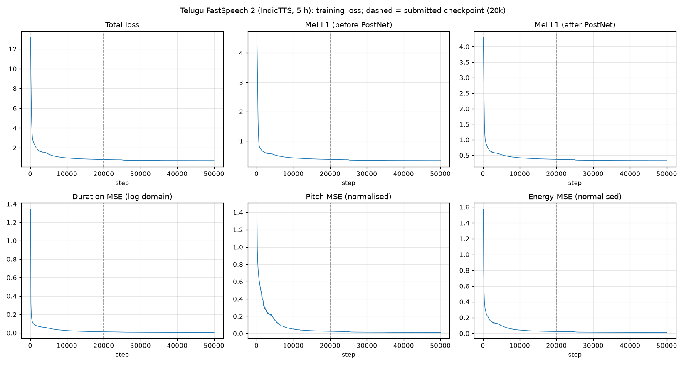
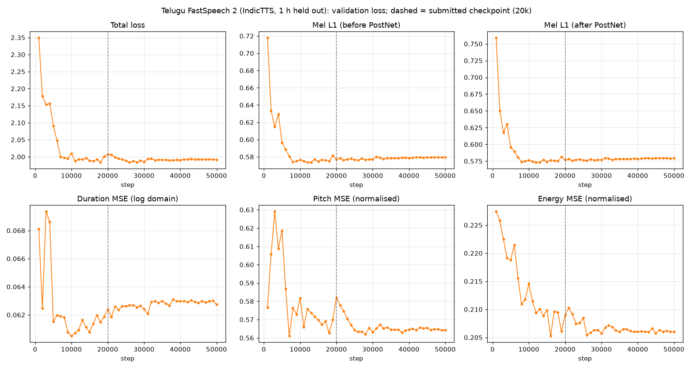
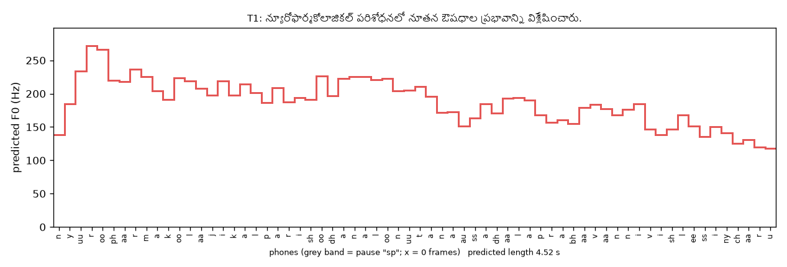

> Both models were trained from scratch and evaluated. Every number below comes from logs and files in the repository; listening judgements are the author's own and are labelled as such.

# 1. Summary

| | English | Telugu |
|---|---|---|
| Data | Svarah (ai4bharat), Indian-accented English, 113 speakers | IndicTTS Telugu (IIT Madras), one male speaker |
| Train / validation | 5.000 h (3,417 utts) / 1.000 h (757 utts), disjoint | 5.000 h (2,625 utts) / 1.001 h (525 utts), disjoint |
| Model | FastSpeech 2 (ming024), 35.4 M parameters, multi-speaker, **trained from scratch** | same architecture, single speaker, Telugu phone set |
| Alignment | MFA 3.4.3, pretrained `english_us_arpa` | MFA 3.4.3 acoustic model **trained on this corpus** with a rule-based Telugu lexicon |
| Vocoder | pretrained HiFi-GAN "universal", **fine-tuned on this model's teacher-forced mels** of the English train split (§7.1) | pretrained HiFi-GAN "universal" (frozen) |
| Training | 50k steps (T4 fp32 for 0–20k, L4 bf16 for 20k–50k) | 50k steps (Colab GPU, bf16 autocast, one uninterrupted run) |
| Submitted checkpoint | step 20,000 (`project/English/checkpoints/20000.pth.tar`) | step 20,000 (`project/Telugu/checkpoints/20000.pth.tar`) |

All parameters of the acoustic model were randomly initialised and trained. No pretrained acoustic weights, frozen layers or LoRA were used. The only pretrained component is the vocoder, which turns mel-spectrograms into waveforms; for English it was additionally fine-tuned on the English training split (§7.1), which does not change the acoustic model.

# 2. Architecture and modifications

**Reference implementation.** [ming024/FastSpeech2](https://github.com/ming024/FastSpeech2) at commit `d4e79eb` (MIT), with its bundled HiFi-GAN (MIT). This is FastSpeech 2 "v1", which uses raw F0 rather than a CWT pitch spectrogram, plus a Tacotron-2 PostNet.

- **Pipeline:** phoneme embedding → 4-layer FFT encoder (256-d, 2 heads, conv 1024, kernel [9, 1]) → speaker embedding (English only) → variance adaptor → 6-layer FFT decoder → linear to 80 mel bins → 5-layer PostNet.
- **Variance adaptor:** three predictors for duration, pitch and energy (2 conv layers, 256 filters, kernel 3, dropout 0.5) and a length regulator. Pitch and energy are predicted at **phoneme level** and fed back as embeddings over 256 linear bins.
- **Loss:** L1(mel) + L1(PostNet mel) + MSE(log(d+1)) + MSE(pitch) + MSE(energy). Pitch and energy are measured in z-scored units, and all terms are masked to valid frames or phones.
- **Training vs inference:**
  - *Training:* the decoder is conditioned on the **ground-truth** durations, pitch and energy (teacher forcing), while the predictors are trained against them.
  - *Inference:* only text (and a speaker id) is given, and the predicted values are used. This is why the validation audio saved during training, which is teacher-forced, sounds better than true text-to-speech output.

**Changes to upstream.** The network, loss, optimiser schedule and Dataset are unchanged.

- **Compatibility patch** (`patches/ming024_fastspeech2_compat.patch`):
  - CPU support for the STFT;
  - keyword arguments for librosa 0.10 or newer;
  - safe `weights_only` checkpoint loading;
  - HiFi-GAN paths that no longer depend on the working directory;
  - UTF-8 `.lab` reading;
  - a fix for an upstream bug where the energy embedding was scaled by the *pitch* control.
- **MFA 3 silences** (`fs2ra/features.py`): MFA 3 leaves pauses as *empty* intervals, which upstream's TextGrid reader drops. Every internal pause would then be missing from the duration sequence, so all targets after the first pause would be misaligned **with no error raised**. Empty intervals are relabelled `sp` before upstream's unchanged `process_utterance` runs.
- **Splits and statistics:**
  - splits come from our manifests;
  - pitch/energy mean, std and bin ranges are fitted on the **train split only** (upstream uses train+val);
  - every utterance is checked: duration sum equals mel frames, one pitch/energy value per phone, all values finite.
- **Training loop** (`fs2ra/training.py`, replacing upstream `train.py`):
  - automatic resume and atomic checkpoint writes;
  - checkpoint pruning plus model-only milestones every 10k steps;
  - CSV loss logs and optional mixed precision (bf16 on L4);
  - a snapshot of `stats.json`, `speakers.json` and the config next to the checkpoints, so inference uses exactly the training normalisation.
- **Symbol table** (`fs2ra/symbols.py`): upstream's `text_to_sequence` silently **drops** unknown phones. The Telugu phone set is appended to the symbol table before the model is built, and training refuses to start if any train or validation phone does not map to an id. English keeps the upstream 360 symbols.
- **Inference** (`fs2ra/inference.py`): a text-only front end, described in §7.

**Feature configuration.**

- 22,050 Hz audio, n_fft 1024, hop 256 (11.6 ms per frame), 80 mel bins, 0–8 kHz, natural-log mel.
- This matches the HiFi-GAN configuration, which is asserted in `tests/test_upstream_compat.py`.
- English audio is 16 kHz and is resampled. Because its Nyquist frequency (8 kHz) equals mel f_max, the mel band has no empty region.

# 3. Data selection and sampling

Hours were measured from the decoded audio, not taken from dataset cards. Each rejected utterance is logged with a reason (`project/<Lang>/splits/rejected.csv`). The splits are:

- deterministic (seed 1234);
- grouped by normalised transcript, so no sentence appears in both train and validation;
- stratified by speaker;
- checked by tests: disjoint ids, audio hashes and transcripts, hour targets, and validation speakers being a subset of training speakers.

**English — Svarah** (`ai4bharat/Svarah` @ `ebbf777`, CC BY 4.0).

- **Corpus:** 6,656 utterances, 9.61 h, 16 kHz. It is an ASR benchmark with read *and* spontaneous speech.
- **Speakers:** there is no speaker column. The 2,938 recording ids are sessions, not people. Each session maps to one demographic profile, and the 115 distinct profiles (the paper reports 117 speakers) are used as speaker ids.
- **Quality control:** removes < 1 s (1,215 utterances), > 15 s (261), too quiet (< −40 dBFS RMS, 160) and speaking-rate outliers (24). This leaves 7.71 h.
- **Split:** 5.04 h train and 1.03 h validation over 113 speakers. The rest is a reserve used only to replace utterances that fail alignment.
- **After alignment** (§4): **train 5.000 h / 3,417 utts, validation 1.000 h / 757 utts**.
- **Why multi-speaker:** the median speaker has only about 1.9 min of training audio (largest 10.6 min), so a single-speaker model is impossible on this corpus.
- **Deliberate asymmetry:** validation was filled first with clean ≤ 11 s, digit-free clips. Train additionally contains 254 utterances of 11–15 s or with digits.

**Telugu — IndicTTS Telugu** (`SPRINGLab/IndicTTS_Telugu` @ `7ab3c18`).

- **Measured vs card:** 36.7 h and two speakers, against the card's ~8.7 h. The female recordings are 16 kHz and mostly long paragraphs (up to 151 s). The male recordings are 48 kHz sentences.
- **Choice: the single male speaker.** It gives 8.06 h of clips ≤ 15 s after quality control, against 3.6 h for the female voice, and it keeps one consistent recording chain.
- **Split:** 5.000 h train (2,623 utts) / 1.000 h validation (524 utts), all ≤ 11 s. **After alignment** (§4): **train 5.000 h / 2,625 utts, validation 1.001 h / 525 utts**.
- **Rejected for quality:**
  - transcripts where a Latin `o` was typed instead of the anusvara `ం` (11 utterances, rejected rather than silently corrected);
  - speaking-rate outliers that turned out to be audio/transcript mismatches.

# 4. Preprocessing

**English.**

1. **Export:** resample 16 → 22.05 kHz, peak-normalise.
2. **Spoken-form text** (`fs2ra/text_en.py`):
   - times ("10:45 AM" → "ten forty five a_m"), years, ordinals and decades;
   - digit strings of 5 or more digits read digit by digit;
   - symbols and abbreviations.

   The same function is used at inference.
3. **Dictionary:** LibriSpeech lexicon with all variants, and g2p_en for 1,395 out-of-vocabulary words (mostly Indian names, places and brands). All-caps acronyms get both a spelled-out and a g2p variant.
4. **MFA 3.4.3** with `english_us_arpa`, speaker-adapted: 4,988 of 4,996 aligned.
5. **Targets** via upstream `process_utterance`:
   - durations from the TextGrid, with leading and trailing silence trimmed;
   - log-mel spectrogram;
   - F0 from WORLD dio + stonemask, linearly interpolated across unvoiced frames and averaged per phone;
   - energy as the per-frame L2 norm of the STFT magnitude, averaged per phone.

   Pitch and energy are z-scored with train-only statistics: pitch mean 176.3 Hz, std 55.3; energy mean 52.5, std 37.7.
6. **Rejection:** 437 utterances whose longest non-silence phone exceeds 0.58 s, mostly filled pauses ("uhh") or untranscribed speech absorbed into a single `AH0`. They were replaced from the reserve without reintroducing train/validation overlap.

**Telugu.**

- **No pretrained MFA model or lexicon exists for Telugu**, so `fs2ra/text_te.py` implements a rule-based grapheme-to-phoneme converter for the Telugu abugida. Its 49 ASCII phones cover:
  - the inherent vowel /a/ and its suppression by virama;
  - vowel signs;
  - homorganic anusvara (`రంగం` → r a ng g a m);
  - vocalic r (`ృ` → r u) and visarga (→ h);
  - geminates.
- **Number verbalisation** handles cardinals, ordinals (`12వ` → పన్నెండవ) and times.
- **Alignment:** an MFA acoustic model is **trained on the Telugu corpus itself** (`mfa train`: monophone → triphone → LDA → two SAT passes) and produces the alignments. It ran on a Colab CPU runtime (`notebooks/align_telugu_colab.ipynb`) in 6,024 s, because the local machine ran out of memory. **3,778 of 3,782** exported utterances (train + validation + reserve) were aligned; the 4 failures were 2 train and 2 reserve utterances.
- **Targets:** the same upstream `process_utterance` and checks as English. 3 further utterances were rejected for an implausibly long phone; all 7 rejected train/validation utterances were replaced from the reserve. Pitch and energy statistics come from the train split only: pitch mean 190.0 Hz, std 43.0; energy mean 49.4, std 32.1.
- **Pitch sanity check.** 190 Hz is high for a male voice, so F0 was re-extracted from 15 random utterances with a second tracker. WORLD dio + stonemask (as in training) and WORLD harvest agree: median 179 Hz, 5th–95th percentile about 120–266 Hz, one mode, no octave-jump cluster. It is the speaker's real, lively reading register, not a tracking error.

# 5. Training setup

| | |
|---|---|
| Optimiser | Adam (β 0.9/0.98, ε 1e-9), Noam warm-up 4,000 steps, ×0.3 at 25k/35k/45k; gradient clip 1.0 |
| Batch | 16 (upstream length-sorted groups of 4 batches) |
| Budget | 50,000 steps ≈ 235 epochs of the English train set (upstream: 900k steps on 24 h of LJSpeech) |
| Validation | full 1 h validation set every 1,000 steps; loss = same objective with teacher forcing |
| Checkpoints | full (model + Adam) every 2k steps, model-only milestone every 10k |
| Hardware (English) | Colab T4, fp32, steps 0–20k (median 0.64 s/step, ≈3.6 h); Colab L4, bf16 autocast, steps 20k–50k after resuming (0.18 s/step, ≈1.5 h). Weights and optimiser state are kept in fp32; the switch is transparent to the optimiser schedule. |
| Hardware (Telugu) | Colab GPU runtime (L4 selected), bf16 autocast (`--amp`), steps 0–50k in one run with no resume; median 0.177 s/step (the same as the English L4 segment), ≈2.5 h. The GPU type is not recorded in the logs. |

# 6. Convergence and instability (English)


- **Stability:** training was stable. There were no NaN or inf values, no loss spikes after warm-up, and resuming and switching GPU and precision at step 20k left no visible discontinuity.
- **Training loss** fell from 13.3 (step 100) to 1.01 (20k) and 0.84 (50k).
- **Validation total** reached 2.65 at 2k, 2.56 at 10k, and its minimum of 2.546 at 18k. It was 2.572 at 20k and 2.570 at 50k: a **plateau from about 8–10k steps**, without divergence.
- **Overfitting:** after about 10k steps the gap widens steadily.
  - Training pitch, energy and duration losses fall to 0.018 / 0.017 / 0.010.
  - The validation values stay at about 0.45 / 0.40 / 0.23.
  - Validation duration loss was actually lowest at 1k steps (0.205) and rose slowly afterwards. The duration predictor memorises the training rhythm early.
- **Comparison with trivial predictors** (validation, normalised units):

  | Predictor | Model | Baseline | Meaning |
  |---|---|---|---|
  | Energy | 0.40 | 1.03 (per-speaker mean) | Genuine learning |
  | Duration | 0.23 | 0.256 (per-phone mean log-duration) | Small gain |
  | Pitch | ≈0.45 | 0.480 (per-speaker mean) | **Little beyond speaker identity** |

  The model's intonation is therefore expected to be flat. The cause is the data: spontaneous ASR speech, about 2 min per speaker, and varied recording conditions. No pipeline bug was found: the target checks pass and the predictors beat their baselines.
- **Checkpoint selection:** validation losses at 20k and 50k are equivalent. The 18k minimum was not kept, because only every 10k is retained as a milestone. Both were synthesised with the same front end, and **20k was preferred on listening**, so it is the submitted checkpoint.

# 7. Inference and generated speech (English)

**Pipeline** (`project/English/inference.py` → `fs2ra/inference.py`):

1. The raw test text, unmodified, goes through the training normaliser and becomes phones.
2. Phrase-final punctuation becomes a pause `sp`, as in upstream `synthesize.py`. (For Telugu only, punctuation phrases are additionally synthesised separately; see §9.2.)
3. The model, conditioned on the speaker embedding, *predicts* durations, pitch and energy, and HiFi-GAN produces the waveform.

**Voice.** Speaker `en_72a36e45` (5.3 min of training audio), chosen as described in §7.2. The first submitted version used `en_edfd2580`, the profile with the most training audio (10.6 min); its audio is kept in `Results/English/previous_speaker_en_edfd2580/`.

**Front-end decisions**, all recorded per word in `Results/English/inference_summary.json`:

| Issue | Decision |
|---|---|
| Lexicon words with several pronunciations | Use the variant MFA aligned most often in the **training** alignments (`project/English/pronunciation_variants.json`, 973 words); otherwise the longest. The LibriSpeech lexicon lists reduced forms first. For example, TWENTY `T W EH1 N IY0` comes before `T W EH1 N T IY0`, but training speakers used the latter 96 times against 19. The first version of inference used the first variant and produced audible "parlimenary" and "twenny". |
| Heteronym *conduct* (E2a/E2b) | An NLTK part-of-speech tag (noun in E2a, verb in E2b) selects g2p_en's homograph entry, which is mapped to the lexicon variant with the same stress position. The noun is K **AA1** N D AH0 K T and the verb K AH0 N D **AH1** K T. |
| E3 `rhyth  m` | Not spell-corrected (the PDF asks to preserve the text; merging into "rhythm" would be silent correction). "rhyth" is out of vocabulary, so g2p_en gives R AY1 DH; "m" is read by its letter name EH1 M, the generic convention for a lone letter. The double space is kept as a pause, so the visible gap is audible (the alternative, collapsing it to an ordinary word gap as standard text cleaners do, is equally defensible). The same rule applies to Telugu T3. No word-specific pronunciation was hard-coded for the test fragments, so the behaviour is what any future malformed input would get. |
| E4 `10:45 AM`, `12 November 2026` | "ten forty five a_m", "twelve november twenty twenty six". The comma becomes a pause. |
| E4 `andaroo` | A Telugu word (అందరూ, "everyone") in English text. g2p_en guesses AE0 N D AA1 R OW0; English phones cannot represent its Telugu vowels exactly. |

**Listening observations** (author; informal, single listener):

- **20k vs 50k:** 20k was preferred over 50k.
- **Voice quality** (with the original universal vocoder): the voice is intelligible but somewhat **robotic**, with an audible background glitch. This is consistent with the flat predicted pitch (§8) and with over-smoothed predicted mels (below and §7.1).
- **Errors heard with the first front end:**
  - "parliamentary" sounded like "parlimenary";
  - *conduct* sounded like "CON-duct" in both E2a and E2b, never "cun-DUCT";
  - E3 was heard as one word, "rythem", with no break;
  - in E4 the date was heard as "twel… twenty six".
- **After the front-end corrections in the table above:** the phone inputs are verifiably correct. They include the T in "parliamentary" and "twenty", the reduced first vowel of the verb *conduct*, and a pause in E3. However, on re-listening **most of these problems were judged still audible**. The remaining errors therefore come from the acoustic model's predicted durations and pitch, analysed in §8, rather than from the input phones.
- **Where the "robotic" glitch comes from** (diagnostic listening test, 3 validation sentences): (1) the original Svarah recording, (2) its ground-truth mel through the vocoder, and (3) our model synthesising the same text for the same speaker. The listener heard **no glitch in (1) or (2), only in (3)**, and judged pronunciation in (3) fine. So neither recording noise nor the vocoder's rendering of real mels explains it: the artefact comes from the acoustic model's **predicted** mel-spectrograms (see §10).

- **Teacher-forced audio also glitches.** The validation samples written during training (real durations, pitch and energy; `output/English/result/*_teacher_forced.wav`) were judged by the listener to have the same glitch and to be not very clearly pronounced, so the decoder itself, not only the variance predictions, produces the over-smoothed mels.
- **After vocoder fine-tuning** (§7.1): the listener judged the **glitch reduced**. The voice still sounds hesitant, "like someone struggling to pronounce", which the vocoder cannot change (see §10).
- **Voice choice** (§7.2): of five candidate speakers, the listener judged `en_72a36e45` the best and it replaced `en_edfd2580`.

## 7.1 Vocoder fine-tuning on the model's own mels (English)

The standard remedy for a vocoder that is fed over-smoothed predicted mels (HiFi-GAN paper, §4.4) was applied without touching the acoustic model:

1. **GTA mels** (`scripts/export_gta.py`): the submitted 20k model, in eval mode and teacher-forced with the ground-truth durations, pitch and energy, regenerated the PostNet mel of every train and validation utterance (4,174; mean L1 to the real mel 0.494). Each was paired with the exact audio span its target mel came from (TextGrid-trimmed, cut to T × 256 samples; the re-analysed mel of the exported audio matches the training target to L1 ≤ 0.013).
2. **Fine-tuning** (`notebooks/finetune_hifigan_colab.ipynb`): official [jik876/hifi-gan](https://github.com/jik876/hifi-gan) @ `4769534` (MIT) with three librosa/PyTorch compatibility edits, started from the official UNIVERSAL_V1 generator *and* discriminators (2.5M steps; the generator is identical to the one bundled with FastSpeech 2), batch 16, fine-tuning mode (input = GTA mel, target = real audio of the **train split only**). Colab L4, 0.62 s/step, 10,600 steps (50 epochs).
3. **Selection:** validation mel L1 (100 held-out validation utterances, jik876 metric) was 0.7193 at 1k steps, **0.7089 at 3k** (minimum), then fluctuated between 0.711 and 0.721 until 10.6k. The 3k-step generator (`project/English/checkpoints/vocoder_hifigan_finetuned_g02503000.pth.tar`, 56 MB, Git LFS) is used for the submitted English audio.
4. **Before/after** on the same 100 validation GTA mels, scored against the real recordings (re-analysed log-mel L1, 0–8 kHz): universal 0.780 ± 0.121, fine-tuned **0.774 ± 0.119**, better on 58/100. The numeric gain is small because the vocoder cannot add detail missing from the input mel; the audible change is the reduced buzz.

The predicted durations, pitch and energy are unchanged by the vocoder. The audio from the original universal vocoder (speaker `en_edfd2580`) is kept in `Results/English/before_vocoder_finetuning/` for comparison. Telugu uses the original universal vocoder: its audio had no comparable artefact.

## 7.2 Choice of the inference voice (English)

The English model is multi-speaker (113 speaker profiles), so the test sentences can be rendered in any training voice; this changes nothing in training. The model does not render all voices equally well. `scripts/speaker_search.py` scores each speaker on **their own validation utterances** (never trained on) by the mean L1 between the model's teacher-forced mel (real durations, pitch and energy given) and the real mel. A second score uses predicted pitch and energy (real durations, so frames still align). 89 speakers have at least 4 validation utterances; the full table is `Results/English/speaker_search.json`.

| Speaker | Training audio | Validation utts | Teacher-forced L1 (rank) | With predicted pitch/energy (rank) |
|---|---|---|---|---|
| en_495812d0 | 1.2 min | 4 | 0.535 (1) | 0.589 (1) |
| **en_72a36e45** | 5.3 min | 11 | **0.609 (2)** | 0.703 (4) |
| en_24481cc0 | 3.3 min | 8 | 0.611 (3) | 0.687 (3) |
| en_afaeffa3 | 2.1 min | 6 | 0.617 (4) | 0.662 (2) |
| en_0b883dad | 5.0 min | 15 | 0.638 (8) | 0.715 (5) |
| en_edfd2580 (first choice) | 10.6 min | 20 | 0.690 (23) | 0.784 (15) |

The most-trained voice is not the best rendered: the score reflects how consistent and clean a speaker's recordings are as much as their amount. Five candidates (table: the four best-ranked, plus en_0b883dad, the best-ranked speaker with at least 15 validation utterances, as the most reliably scored) were rendered on all five test sentences with the fine-tuned vocoder, and the listener chose **`en_72a36e45`** by ear. A low L1 is only a guide (quiet or clean recordings score well; en_495812d0's score rests on 4 utterances), which is why the final choice was made by listening. Compared with `en_edfd2580`, the chosen voice is predicted to speak more slowly (11.3–13.5 vs 12.3–15.5 phones/s) and with a wider pitch range (sd 21–23 vs 11–16 Hz), §8.

# 8. Variance-adaptor analysis per sentence (English)

All values are the model's *predictions* at inference. One frame is 11.6 ms. The plots are in `Results/English/variance_adaptor_plots/{duration,pitch,energy}/`.

| | Length | Phones/s | Predicted F0 mean ± sd (range) | Notes |
|---|---|---|---|---|
| E1 | 6.51 s | 13.5 | 201 ± 22 Hz (163–290) | antidisestablishmentarianism: 174 frames (2.0 s); the primary stress EH1 gets 7 frames, the pitch peak (290 Hz) falls on the unstressed AY0 |
| E2a | 4.42 s | 11.8 | 185 ± 21 Hz (102–228) | *conduct* noun: AA1 12 frames vs AH0 6; AA1 not higher in pitch (179 vs 178 Hz) |
| E2b | 4.27 s | 13.1 | 192 ± 23 Hz (131–256) | *conduct* verb: AH1 5 frames vs AH0 7; AH1 F0 +7 Hz, energy +60 % |
| E3 | 3.27 s | 11.3 | 196 ± 23 Hz (169–254) | 22-frame (0.26 s) pause between "rhyth" and "m" |
| E4 | 6.82 s | 11.7 | 202 ± 22 Hz (161–261) | 33-frame (0.38 s) pause at the comma; stressed vowels in "twelve" and "november" 4 frames (46 ms) each |

Values for speaker `en_72a36e45`; those of the first voice, `en_edfd2580`, are in `Results/English/previous_speaker_en_edfd2580/inference_summary.json` (F0 sd 11–16 Hz around 127–140 Hz, 12.3–15.5 phones/s).


- **Pitch** varies with an sd of 21–23 Hz around a 185–202 Hz centre in every sentence (wider than the first voice's 11–16 Hz, mostly the speaker's own range). There is still no clear phrase-level declination or question/statement contour. This is the flat intonation predicted by the baseline comparison in §6.
- **Lexical stress is weakly encoded.**
  - In E2a the noun's stressed vowel is lengthened (10 vs 5 frames) but not raised in pitch.
  - In E2b the verb's stressed vowel is slightly higher and louder but *shorter* than the unstressed one.

  Both cues are small, which matches the listener hearing no clear noun/verb contrast.
- **Durations** are plausible overall (11.3–13.5 phones/s; no zero-length phones; pauses of 0.26–0.38 s at punctuation and at the E3 double space). Dense number and date regions are compressed, however: "twelve" lasts 17 frames (0.20 s), and the stressed vowels in "twelve" and "november" get 4 frames. That matches the "twel… twenty six" heard with the first voice. Spoken dates are rare in Svarah, and the duration predictor overfits early (§6).
- **Energy** follows the phone classes as expected (vowels high, closures and `sp` low). It is the best-learned predictor (§6).

# 9. Telugu results

## 9.1 Convergence





- **Stability:** no NaN/inf values and no loss spikes after warm-up.
- **Training loss** fell from 13.18 (step 100) to 0.80 (20k) and 0.69 (50k).
- **Validation total** was 2.35 at 1k, 2.18 at 2k and 2.01 at 10k, with its minimum of 1.984 at 18k; 2.007 at 20k, 1.986 at 30k and 1.992 at 50k. As for English, it **plateaus from about 8–10k steps** without diverging.
- **Overfitting:** training pitch / energy / duration losses reach 0.014 / 0.014 / 0.006 at 50k, while validation stays at about 0.56 / 0.21 / 0.063. Validation duration loss is lowest at 10k (0.0605) and pitch at 7k (0.561).
- **Comparison with trivial predictors** (validation, normalised units; same definitions as §6):

  | Predictor | Model (20k) | Baseline | English, for comparison |
  |---|---|---|---|
  | Pitch | 0.58 | 1.06 (speaker mean) | 0.45 vs 0.48 |
  | Energy | 0.21 | 1.09 (speaker mean) | 0.40 vs 1.03 |
  | Duration | 0.062 | 0.131 (per-phone mean log-duration) | 0.23 vs 0.256 |

  Unlike English, every Telugu predictor roughly **halves (or better) the error of its baseline**, including pitch. With the same code, architecture and training budget, a single studio speaker reading prepared text gives learnable prosody, whereas Svarah's spontaneous multi-speaker ASR audio does not. This is the clearest evidence in this project that the English model's flat prosody comes from the data.
- **Checkpoint selection.** The kept milestones are close on validation (20k 2.007, 30k 1.986, 50k 1.992). All three were synthesised. On listening, **20k was preferred**; 30k sounded "odd" to the listener (50k received no specific comment), so 20k is submitted, matching the English choice.

## 9.2 Inference (Telugu)

Same pipeline as §7, with the rule-based Telugu front end (`fs2ra/text_te.py`) and the single speaker `te_male`. Per-word phones are in `Results/Telugu/inference_summary.json`.

| Issue | Decision |
|---|---|
| T2a / T2b `పట్టు` ("grip" / "silk") | Same spelling and the same pronunciation, so both get identical phones `p a tt tt u`. Only the surrounding context differs; no semantic disambiguation is attempted (none is needed for pronunciation). |
| T3 `అడ  విలో` | Not corrected to అడవిలో. The double space inside the word is kept as a pause, as for English E3. |
| T4 digits and time | Verbalised by the front end: "రెండు వేల ఇరవై ఆరు నవంబర్ పన్నెండవ తేదీ ఉదయం పది నలభై ఐదు గంటలకు". Digits never occur in the training transcripts, so this is the only way the model can speak them. |
| T4 comma: voiced "pause" | In the first synthesis the comma pause was **voiced** at every checkpoint (20k, 30k, 50k): the "silence" had a higher RMS (0.096) than the vowel before it and was heard as an "aaa". All 7,302 pauses in the training targets are silent (median energy 0.6 vs 63.6 for vowels), so the decoder fails here only in a long (120-phone) sentence. **Fix (inference only, Telugu config `split_at_punctuation`):** each punctuation-delimited phrase is synthesised in its own forward pass and the phrases are joined with digital silence whose length is the pause duration the model predicted for that `sp` in the whole-sentence pass (20 frames, 232 ms). The T3 double-space pause stays inside one pass (it splits a word, and it was already silent). |
| Speed | The listener found 20k "very fast". Measured, it matches the speaker: 14.6–16.6 phones/s at inference vs a training median of 14.9 (10th–90th percentile 13.1–16.4). FastSpeech 2's duration control (`--pace`, which scales predicted durations before rounding) was used to render 10 % and 20 % slower versions; the listener chose the **unmodified pace (1.0)** for submission. |

**Listening observations** (author; informal, single listener, **not a fluent Telugu speaker**, so pronunciation accuracy could only be judged coarsely):

- 20k was judged "good" but "very fast" at first; after the speed comparison, 20k at normal pace was judged "good to go".
- **T1** `ఔషధాల` was heard as "ushadhalu" rather than "aushadhalu". The input phones are correct (`au ss a dh aa l a`). The cause is data coverage: the diphthong `au` occurs 148 times in the training phones, almost always as a vowel sign after a consonant, and a word-initial `ఔ` occurs **once** in the 5 h (ఔట్). In T1 it also follows a vowel (నూతన ఔషధాల). The model predicts `au` at energy 40 against a training median of 91, so its onset is weak and merges with the preceding /a/.
- **T4** comma: the "aaa" sound before the fix was heard by the listener; after phrase-level synthesis the pause is silent (measured RMS 0.000).

## 9.3 Variance-adaptor analysis per sentence (Telugu)

| | Length | Phones/s | Predicted F0 mean ± sd (range) | First → last third F0 | Notes |
|---|---|---|---|---|---|
| T1 | 4.52 s | 14.6 | 188 ± 34 Hz (118–272) | 212 → 154 Hz | `au` 15 frames, low energy (above) |
| T2a | 2.07 s | 15.0 | 187 ± 30 Hz (115–234) | 201 → 157 Hz | `పట్టు`: geminate closure 5 + 3 frames |
| T2b | 2.26 s | 16.3 | 192 ± 35 Hz (120–253) | 215 → 160 Hz | `పట్టు`: geminate closure 7 + 3 frames |
| T3 | 2.11 s | 15.3 | 182 ± 36 Hz (113–264) | 196 → 160 Hz | double-space pause only 7 frames (81 ms) |
| T4 | 7.40 s | 16.6 | 191 ± 31 Hz (102–260) | 199 → 174 Hz | comma pause 20 frames (232 ms), synthesised as silence |



- **Pitch** has a real sentence contour: every sentence declines from its first to its last third by 25–58 Hz, and the F0 spread (sd 30–36 Hz) is more than twice the English model's (11–17 Hz). This is the predicted-pitch counterpart of the baseline comparison in §9.1.
- **Durations** are plausible: no zero-length phones, and the geminate `ట్ట` in `పట్టు` gets a long closure in both T2a and T2b. As expected for identical phones, the two `పట్టు` differ only slightly (7 vs 5 frames of closure), driven by context.
- **Pauses:** the T3 double-space pause is predicted, but at 81 ms it is much shorter than English E3 (310 ms) and may be barely audible.
- **Pre-registered expectations (from the earlier draft) checked:** T2a/T2b get identical phones (confirmed); T3's split word is rendered with a pause (confirmed, but short); T4's digits are verbalised exactly as listed (confirmed).

# 10. Failures and limitations

- **English data is not TTS data.**
  - Spontaneous, multi-condition ASR recordings at 16 kHz with about 2 min per speaker limit prosody (pitch barely beats the speaker mean) and voice quality.
  - A clean single-speaker English corpus would be expected to sound far more natural, but the assignment fixes the dataset.
- **Overfitting.** Validation loss plateaus after about 10k steps, so 50k steps is more than this data supports. Stronger regularisation, a smaller model or early stopping on validation would be the next experiments. A 10k-step milestone interval was too coarse to keep the validation minimum (18k).
- **Teacher forcing vs inference gap.** Validation losses and teacher-forced samples overstate the quality of real text-to-speech output, because errors in predicted durations and pitch only appear at inference.
- **Over-smoothed predictions (English glitch).** The listening test in §7 locates the English artefact in the predicted mels. This matches the known over-smoothing of FastSpeech 2: an L1/MSE-trained decoder predicts a conditional average, which the vocoder renders as buzz (Kögel et al., Interspeech 2023; Ren et al., *Revisiting Over-Smoothness in Text to Speech*, ACL 2022). Fixes from the literature all need retraining: GAN or flow decoders, mixture-density outputs, or joint acoustic model + vocoder training (JETS, 2022). Fine-tuning the vocoder on the model's own (teacher-forced) mels is the cheaper standard alternative, and was done (§7.1): it reduced the glitch but cannot sharpen the mels themselves. The decoder-side fixes were not possible before the deadline.
- **Hesitant English delivery.** Even with real (teacher-forced) prosody the decoder's pronunciation is not crisp on unseen sentences (train mel L1 0.37 vs validation 0.58 at 20k). With about 2–3 min of mostly spontaneous speech per speaker, the decoder learns blurred, speaker-averaged phones, and the duration predictor learns little beyond a per-phone average (§6). Within the assignment's constraints (FastSpeech 2 trained from scratch on 5 h of Svarah) the main remaining lever would be better alignments (adapting the MFA acoustic model to Svarah); pretrained acoustic initialisation was deliberately not used.
- **Post-hoc prosody rules (tried, not adopted).** Generic rules applied to the predicted durations and pitch before a second decoder pass (stressed-vowel duration floor, pitch-range expansion, stress accent, phrase-final lengthening and fall, overall pace, closing double-space pauses) were calibrated on the training split and half of the validation split and scored on the other half (branch `prosody-experiment`, `scripts/prosody_calibrate.py`). Only pitch-range expansion (×1.51: predicted F0 sd 64 % → 97 % of real) and pace (×1.045: utterance length 0.95 → 0.99 of real) moved their measures towards real speech; the model already matched real speech on stress, phrase-final behaviour and stressed-vowel length. The listener heard no clear difference, so none were adopted.
- **Vocoder.** As an additional tested alternative (not used for the submitted audio; `--vocoder bigvgan`, `scripts/vocoder_eval.py`), NVIDIA BigVGAN-v2 (22 kHz, 80 bands, f_max 8 kHz, same mel definition) reproduced real validation mels more faithfully on 40/40 utterances per language (re-analysed log-mel L1: English 0.235 vs 0.327, Telugu 0.321 vs 0.394). On listening it did **not** remove the English glitch, consistent with the artefact being in the predicted mels.
- **Telugu coverage.** Rare phones and contexts are poorly learned (word-initial `ఔ` occurs once in 5 h; heard as "ushadhalu" in T1). The submitted Telugu audio was judged by a listener who is not a fluent Telugu speaker; an automatic intelligibility test (ASR character error rate) was considered but not run.
- **Telugu long-sentence pause.** The decoder voiced a predicted pause in T4; phrase-level synthesis at punctuation is an inference-time workaround, not a model fix.
- **Front end:**
  - English heteronym handling relies on a part-of-speech tagger and g2p_en's homograph list;
  - out-of-vocabulary words (*rhyth*, *andaroo*) depend on g2p_en guesses;
  - code-mixed Telugu words in English text cannot be pronounced natively with ARPAbet phones;
  - the Telugu G2P is rule-based and does not model schwa deletion or sandhi beyond the rules listed in §4.
- **Speaker proxy (English).** Speaker ids are demographic profiles, and up to two pairs of real speakers may be merged.

# 11. Reproduction

Repository: <https://github.com/shishirshetty111/fastspeech2-svarah-telugu> (see `project/README.md`).

```bash
# setup (Python 3.11; CPU torch locally, Colab's preinstalled CUDA torch for training)
pip install -r requirements.txt && python scripts/setup_upstream.py
python -m pytest tests -q

# data: download + inventory + deterministic splits (Svarah needs HF_TOKEN in .env)
python scripts/data/download_datasets.py && python scripts/data/build_inventory.py && python scripts/data/make_splits.py

# English
python project/English/preprocess.py --stage export align features   # MFA 3.4.3 via FS2_MFA_CMD
python scripts/package_features.py english                            # -> Colab: notebooks/train_colab.ipynb
python project/English/train.py --amp                                 # resumable; 50k steps
python scripts/pronunciation_variants.py                              # lexicon variants used in training
python scripts/export_gta.py english --ckpt project/English/checkpoints/20000.pth.tar   # GTA mels -> Colab: notebooks/finetune_hifigan_colab.ipynb
python project/English/inference.py --out_dir project/Results/English # 20000.pth.tar + fine-tuned vocoder (config inference.vocoder)

# Telugu
python project/Telugu/preprocess.py --stage export                    # then notebooks/align_telugu_colab.ipynb (Colab CPU)
python project/Telugu/preprocess.py --stage features                  # after extracting telugu_alignment.tar into data/
python scripts/package_features.py telugu                             # -> Colab: notebooks/train_colab.ipynb, LANG="Telugu"
python project/Telugu/train.py --amp
python project/Telugu/inference.py --out_dir project/Results/Telugu   # uses checkpoints/20000.pth.tar; split_at_punctuation
```

**Software:** Python 3.11 (local) and Colab's default Python 3, PyTorch 2.5 CPU / Colab CUDA build, MFA 3.4.3 (conda-forge), librosa 0.10, pyworld 0.3.5, g2p-en 2.1.0. **Licences:** upstream FastSpeech 2 and HiFi-GAN (MIT) notices are retained; Svarah is CC BY 4.0; IndicTTS is under the IIT Madras licence. No audio or transcripts are redistributed.
